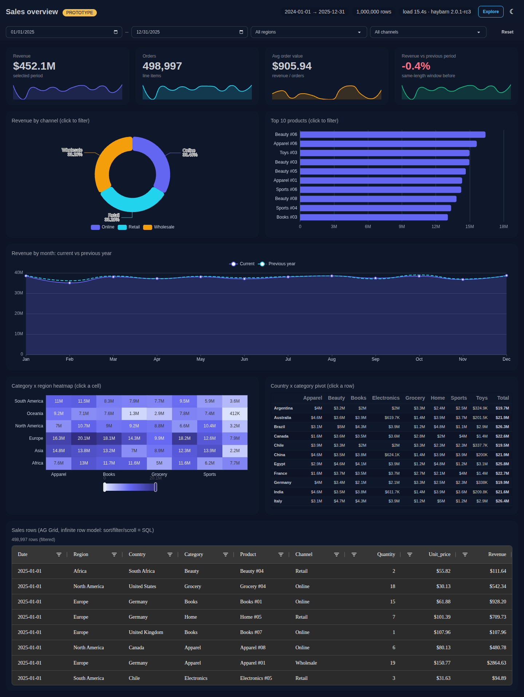

# Dashboard stack probes (research, 2026-11-23/24)

Status: evidence. This note decides nothing. The decisions are in [ADR 0001](../adr/0001-dashboard-stack.md) and [spec 0001](../specs/2026-11-24-0001-featherbi-v1.md).

## Question

Can a single HTML file, opened in the browser, show an impressive and fluid BI dashboard over 1 M rows? Which engine and UI libraries does that need?

## Setup

- **Data:** 1,000,000 synthetic sales rows, generated with a deterministic hash: 2024–2025, 6 regions, 20 countries, 8 categories, 60 products, 3 channels.
  - Generating the data twice gave the same result (SUM(revenue) = 906930452.95).
  - Parquet zstd: 8.8 MB.
  - The data is embedded as base64, so the file is 11.7–12.3 MB.
- **Measurement:** headless Chromium 151 with a software GPU (swiftshader) on a shared 4-core host. Load average was 4–14 during the runs, so absolute times are inflated and noisy. Only compare variants measured in the same run.
- **Prototype code:** throwaway, under `~/.local/state/factory/featherbi/proto`; it will be deleted once the owner has finished testing it. The round-3 tile config is kept in [assets/…/prototype-config.json](assets/2026-11-24-dashboard-stack/prototype-config.json).

## Findings

### Engine

- **No browser build of Postgres or Delta.** Neither upstream duckdb-wasm nor Haybarn-Wasm publishes a `postgres_scanner` or `delta` Wasm extension, for any DuckDB version from 1.4 to 2.0.1 (HTTP 404). Postgres needs raw TCP, which a browser does not have.
- **Upstream `@duckdb/duckdb-wasm`** is still on 1.33.1-dev on npm, based on DuckDB 1.5.x. A 2.0 announcement was drafted for 2026-11-24.
- **Haybarn-Wasm 2.0.1-rc3** (Query.Farm, MIT) is a drop-in fork on DuckDB v2.0.1.
  - `iceberg`, `ducklake`, `excel`, `sqlite_scanner` and `httpfs` load with `INSTALL`/`LOAD` in the Wasm build.
  - It has no `getJsDelivrBundles`: the `base` bundle must be built by hand, and `apache-arrow@17` needs an import map.
- **Perspective's `DuckDBHandler`** works on Haybarn without changes.
- **Start-up time** of Haybarn vs duckdb-wasm 1.32 could not be told apart on this host; the run-to-run spread was larger than the difference.

### UI

- **Perspective 5.10** has 17 plugins, and its viewer configs restore from JSON.
  - On `file://` its chart worker fails to start (a `blob:null` URL).
  - Two build-time patches fix this: on `file:` origins they turn `blob:` URLs into `data:` URLs, and the patched bundle is inlined as a `data:` module.
- **Round 2: Perspective in the filter path.** Tiles: 4 KPI, 3 ECharts, Perspective heatmap and pivot.
  - Load took 21–28 s and a cross-filter click 7.5–8.8 s.
  - The Perspective heatmap alone took 7.4–8.2 s per filter change, while the KPI and ECharts SQL took 0.5–1 s.
- **Round 3: Perspective only behind an "Explore" button.** Tiles: ECharts heatmap, a pivot computed with DuckDB `GROUPING SETS` and shown as a DaisyUI table, and an AG Grid Community 34.3.1 infinite table backed by SQL.
  - Both rounds were measured in the same run.

  | Metric | Round 2 | Round 3 |
  |---|---|---|
  | Load | 22–28 s | 6–8 s |
  | Cross-filter click | 7.5–8.8 s | 1.3–1.5 s |
  | Slowest tile | 7.4–8.2 s | 0.9 s |
  | AG Grid sort | — | 0.3–0.9 s |
  | Explore, first open | — | about 3 s |

  - The first, calmer filter runs took 0.8–1.0 s.
  - Later runs were 5–11 s even though every tile's SQL finished within 1.2 s. I attribute those to host contention and software rendering, but did not isolate the cause.
- **Plain `file://`:** all variants render with zero console errors. Cross-filtering by clicking the donut, a bar, a heatmap cell or a pivot row works.
- **Theme:** light/dark switching works across DaisyUI, ECharts and Perspective together.
- **CSS:** DaisyUI 5 + Tailwind 4 generated at build time and inlined is 137–142 KB.
- **Tile config:** tiles are plain JSON — `kpi`, `echarts` (option with `@points`/`@col`/`@uniq`/`@heat` data bindings), `pivot` (SQL returning `r, c, v`), `table`, `perspective`. The renderer is generic over this config.

### Live sources (desk research, not probed)

- **pg_ducklake** keeps its catalog in Postgres and its data as Parquet in S3. A browser can read it with `ATTACH 'ducklake:…'` from an exported catalog plus S3 that sends CORS and Range headers.
- **pg_lake** writes Iceberg tables to S3. Their `metadata_location` is shown in the `iceberg_tables` view, so `iceberg_scan` can read them; a REST catalog also works.
- **Grainlift** (Query.Farm, 0.6) is a gateway that runs ADBC drivers on a server. With it, Haybarn in the browser can query plain Postgres.
- These are untested. The servers are only reachable from the internal network.

## Not verified

- Firefox, Safari, mobile devices.
- Timing on a quiet machine with a real GPU.
- Excel, Iceberg and DuckLake reads inside the browser (only extension loading was checked).
- The size of a fully offline file (estimated over 60 MB).

